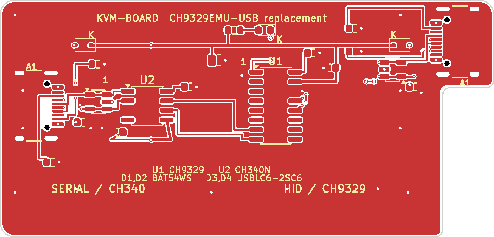

# kvm-board — CH9329 USB キーボード/マウスエミュレータ

MR-CH9329EMU-USB（マルツの CH9329 モジュール）の代替を JLCPCB の SMT 実装で作るための KiCad プロジェクトです。シリアル側とキーボード/マウス側の両方を USB Type-C にしています。



- 基板: 65.4 × 31.4 × 1.6 mm、2 層、公開 FRISK-CASE 3D モデルの内トレイに合わせた寸法
- 回路図: [docs/schematic.pdf](docs/schematic.pdf)
- データシートとシルクの対応: [docs/datasheets.md](docs/datasheets.md)
- 配線図: [docs/pcb_routing.png](docs/pcb_routing.png)（GND ベタを消して配線を見やすくしたもの）
- 部品: 21 点、10 種類。すべて JLCPCB の在庫部品（2026-10 時点）
- ファームウェア不要。CH9329 の内蔵ファームで動きます

## 仕様

| 項目 | 内容 |
| --- | --- |
| 基板寸法 | 65.4 × 31.4 mm、t1.6 mm、2 層 |
| コネクタ | USB Type-C レセプタクル ×2（HRO TYPE-C-31-M-12） |
| J1 (SERIAL) | CH340N 経由の USB シリアル。制御側 PC に接続 |
| J2 (HID) | CH9329 の USB HID。操作対象の PC に接続 |
| 給電 | どちらの Type-C からでも給電可。BAT54WS でダイオード OR |
| シリアル | 9600 bps / 8N1（CH9329 出荷時設定） |
| 動作モード | CH9329 Mode 0（キーボード + マウス + カスタム HID の複合デバイス）、プロトコルモード |
| 表示 | ACT# の LED（HID 側の USB 設定完了で点灯） |

J1/J2 はどちらもデバイス側（CC に 5.1k の Rd）です。ホスト PC とは C-to-C でも C-to-A でも接続できます。充電器は接続しないでください。

## 回路

```
制御側 PC ──Type-C(J1)── CH340N ──UART── CH9329 ──Type-C(J2)── 操作対象 PC
                              (TXD→RXD, RXD←TXD, 9600 8N1)
```

- CH9329: 5 V 給電。V33 に 0.1 µF、VCC に 0.1 µF。内蔵発振なので水晶なし。
- CH340N: 5 V 給電。V3 に 0.1 µF。内蔵クロックなので水晶なし。
- ESD: 各ポートに USBLC6-2SC6。クランプ用の VBUS ピンは各ポートのローカル VBUS に接続し、100nF (C6/C7) で GND にデカップリング。
- 5 V は BAT54WS ×2 で OR 接続。IC には約 4.7 V が入ります（CH340N の最低 4.0 V、CH9329 の最低 3.7 V の範囲内）。
- CH9329 の MODE0/MODE1、CFG0/CFG1、SET、DEF、RST は未接続。内蔵プルアップ/プルダウンで Mode 0・プロトコルモード・9600 bps になります。UP は 5 V 動作なので未接続です。
- 設定を変えたい場合は U1 の 11 番 (SET) を GND に落としてから WCH の設定ツールで書き換えます。SET はテストパッドを出していないので、必要なら U1 のピンに直接配線してください。

## 部品表

`fab/bom_jlcpcb.csv` がそのまま JLCPCB の BOM です。

| 記号 | 値 | パッケージ | LCSC | 備考 |
| --- | --- | --- | --- | --- |
| J1, J2 | TYPE-C-31-M-12 | USB-C 16P | C165948 | HRO |
| U1 | CH9329 | SOP-16 | C2838834 | WCH |
| U2 | CH340N | SOP-8 | C2977777 | WCH |
| D1, D2 | BAT54WS | SOD-323 | C22629 | ショットキー |
| D3, D4 | USBLC6-2SC6 | SOT-23-6 | C7519 | ESD |
| R1–R4 | 5.1k | 0603 | C23186 | CC 用 |
| R5 | 1k | 0603 | C21190 | LED 用 |
| C1–C4, C6, C7 | 100nF | 0603 | C14663 | 50V X7R |
| C5 | 10uF | 0805 | C15850 | 25V X5R |
| LED1 | KT-0603R | 0603 | C2286 | 赤 |

基本部品（C23186、C21190、C14663、C15850、C2286）以外の 5 種類は拡張部品です。拡張部品は 1 種類あたりの実装手数料がかかります。

## JLCPCB での発注

基板:

- 2 層、65.4 × 31.4 mm、t1.6 mm、FR-4、HASL、1 oz
- 最小配線幅/間隔 0.15/0.15 mm、ビア 0.5/0.3 mm。データ線のエスケープに 0.35/0.15 mm のビアも使っています。JLCPCB の標準能力内です。

実装:

- 表面のみ、21 点。
- アップロードするファイル:
  - ガーバー: `fab/kvm-board-gerbers.zip`
  - BOM: `fab/bom_jlcpcb.csv`
  - CPL: `fab/cpl_jlcpcb.csv`
- ガーバー、ドリル、CPL はすべて基板左下を原点にした座標です（KiCad のドリル/配置原点を使用）。ガーバー zip と CPL はセットで再アップロードしてください。JLCPCB の部品ライブラリ向けの回転補正を入れてあります（SO-8/SO-16 +270°、SOT-23-6 +270°。Type-C、SOD-323、LED、0603 は回転補正なし）。Type-C は基板側でフットプリントを 180° 回して開口を外側、SMT パッドを基板内側に置いています。CPL は JLC 側の原点に合わせて X を 1.571 mm 補正しており、出力は J1 270° / J2 90°、位置は J1 5.2 mm / J2 60.2 mm です。補正値は `scripts/make_jlc_files.py` にあります。実装プレビューで向きを確認してください。

注意:

- Type-C コネクタ (C165948) はシェル固定タブが THT 形状ですが、JLCPCB の SMT 実装部品リストに含まれている部品です。SMT 実装で発注できます。
- Type-C の VBUS パッドには 0.5/0.3 mm のビアをパッド内に置いています（4 個）。2 層・ビアテントで製造できますが、JLCPCB の DFM が via-in-pad を指摘した場合はそのまま進めて問題ありません。気になる場合は該当パッド (J1/J2 の A4/B9、A9/B4) を未接続にしても、50 mA 程度の消費電流なら残りの VBUS 接点で足ります。
- ガーバーは KiCad 10 の既定（X2、4.6 フォーマット）です。

## フリスクケースへの組み込み

基板外形は、公開されている FRISK ケースの 3D CAD モデルに合わせた **65.4 × 31.4 mm** です。

### ケース寸法の出典

- モデル配布ページ: [3D PRINT用モデルデータ — FRISK CASE](https://try3dcg.world.coocan.jp/note/3dPrint/3dPrint.html#FRISK-CASE)
- モデル: [FRISK-CASE.zip](https://try3dcg.world.coocan.jp/files/FRISK-CASE.zip)
  - `FRISK_CASE1.stl` … 下トレイ、`FRISK_CASE2.stl` … フタ
- 2026-10 時点で上記 zip を取得し、`FRISK_CASE1.stl` の z=-4.0 mm 断面を 0.05 mm 格子で測定:
  - 内トレイ: **66.4 × 32.4 mm**
  - ラッチ用の張り出し: モデル座標の左上に **7.8 × 20.3 mm**
  - 外寸: 69 × 37 mm、下トレイの高さ 9.8 mm
- 基板は内トレイから 0.5 mm ずつ逃がした **65.4 × 31.4 mm**。ラッチ張り出しに合わせて、基板座標の右下を **6.8 × 19.8 mm** 切り欠いています。
- このモデルは実物のフリスクケースを 3D プリント用に起こしたものです。印刷公差があるため、初回は必ず現物合わせで確認してください。実物のフリスクケース（58.8 × 32.8 mm など）とは寸法が異なります。

### 基板の向きと切り欠き

- 基板の右下の切り欠きを、ケースのラッチ張り出しに合わせて置きます。切り欠きを埋めたり、基板を逆にして差し込んだりしないでください。
- J1 (SERIAL) は基板左端、上から 14.0 mm の位置。J1 が当たるケース側壁に約 10 × 4 mm の切り欠きを開けてください。
- J2 (HID) は基板右端、上から 5.5 mm の位置（ラッチ切り欠きの上のローブ）。J2 が当たるケース側壁に約 10 × 4 mm の切り欠きを開けてください。
- 基板をトレイ底面に置いた場合、コネクタの口は底面から 1.6〜4.9 mm の高さに来ます。切り欠きは底面から 1.4〜5.1 mm くらいを目安にしてください。
- 固定用の穴はありません。両面テープやスポンジで固定します。基板とトレイの間に 1 mm 程度のスペーサーを入れると、プラグの挿入量を稼げます。
- 実機のケースで必ず確認してください。内寸が違う場合は基板外形を調整できます。

## 使い方

1. J2 (HID) を操作対象の PC に接続します。キーボード/マウスとして認識され、LED が点灯します。
2. J1 (SERIAL) を制御側の PC に接続します。CH340 の USB シリアル（Linux なら `/dev/ttyUSB0`）として見えます。
3. 9600 bps / 8N1 で CH9329 のプロトコルを送ります。

'A' を押して離す例（CH9329 プロトコル、チェックサムは全バイトの和の下位 8 bit）:

```python
import serial
s = serial.Serial("/dev/ttyUSB0", 9600, timeout=1)
s.write(bytes.fromhex("57 AB 00 02 08 00 00 04 00 00 00 00 00 10"))  # press A
s.write(bytes.fromhex("57 AB 00 02 08 00 00 00 00 00 00 00 00 0C"))  # release
```

プロトコルの詳細は WCH の CH9329 データシートと「CH9329 シリアル通信プロトコル」を参照してください。

## 設計メモ

- シリアル側と HID 側は独立した USB デバイスです。2 台の PC の GND がケーブル経由で共通になります。これは元の MR-CH9329EMU-USB と同じです。
- ESD 保護素子の VBUS ピンは、ダイオード OR の前の各ポートのローカル VBUS に接続しています。VBUS-GND 間の 100nF (C6/C7) は USBLC6 の近くに置き、ESD 時のクランプ電圧を安定させています。
- Type-C の 4 つの VBUS 接点はすべて接続しています。パッドが 0.6 mm 幅なので、0.5/0.3 mm のビアをパッド内に置いて B.Cu で引き回しています。
- GND は両面ベタ。USB の D+/D- は全速 12 Mbps なので、特にインピーダンス制御はしていません。
- 部品番号のテキストは U1/U2 以外はシルクから外しています（実装は CPL で行うため）。

## ファイル構成

```
kvm-board.kicad_pro       KiCad プロジェクト（DRC ルール・ネットクラス込み）
kvm-board.kicad_sch       回路図
kvm-board.kicad_pcb       基板（配線・ベタ済み）
lib/kvm.kicad_sym         シンボルライブラリ
lib/KVM.pretty/           フットプリント（KiCad 公式ライブラリから取得）
fp-lib-table              KVM.pretty の登録
sym-lib-table             kvm.kicad_sym の登録
fab/                      ガーバー zip、BOM、CPL、KiCad 位置ファイル
docs/                     回路図 PDF、基板画像
scripts/                  設計データ生成スクリプト
AGENT.md                  エージェント向けの再生成・検証手順
```

## 再生成

KiCad 10 の `kicad-cli` と Python の `pcbnew` が必要です。

```sh
python3 scripts/gen_sch.py     # 回路図
python3 scripts/gen_pcb.py     # 基板（ゼロから生成）
./scripts/export_fab.sh        # ガーバー、BOM、CPL
./scripts/gen_docs_images.sh   # docs の基板画像
```

Docker しかない場合は `scripts/kicad.sh` 経由で同じコマンドを実行できます。手順は [AGENT.md](AGENT.md) にまとめています。

`kvm-board.kicad_pcb` は `scripts/gen_pcb.py` が生成します。GUI で直接編集すると次回の生成で上書きされるので、変更はスクリプト側に入れてください。回路図も同様に `scripts/gen_sch.py` から生成しています。

## 検証

- ERC: 0 件
- DRC: 0 件（エラー・警告とも）
- 回路図のネットリストと基板のパッドネットは一致
- `kicad-cli pcb drc` / `kicad-cli sch erc` で確認済み

## ライセンス

MIT。詳細は [LICENSE](LICENSE) を参照してください。

基板の製造・実装・ケース加工は自己責任で行ってください。特に Type-C のシェル固定タブ、VBUS パッド内のビア、ケースの切り欠きは、発注前に各自の環境で確認してください。
